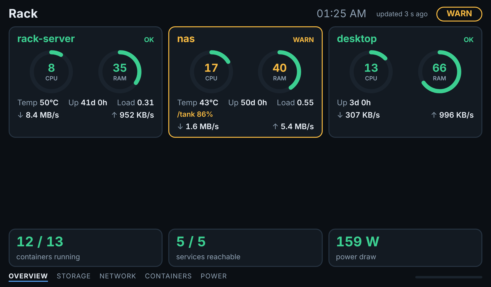
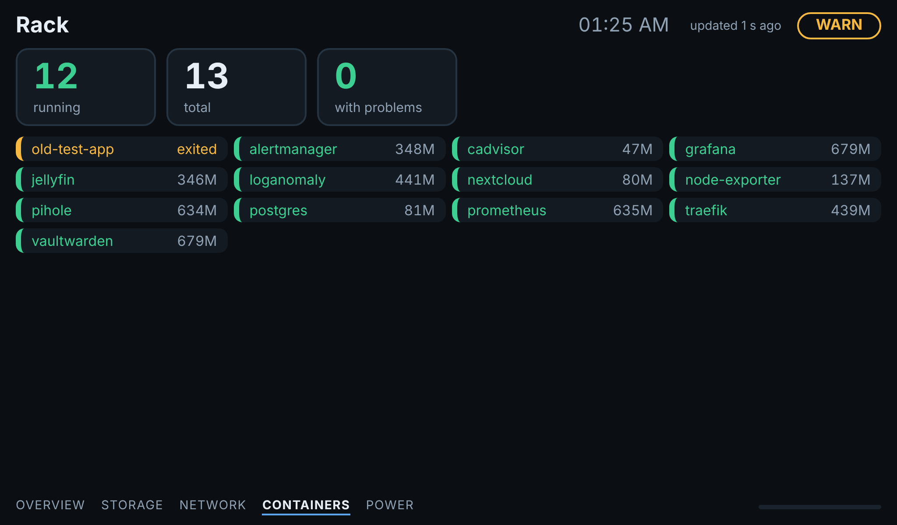
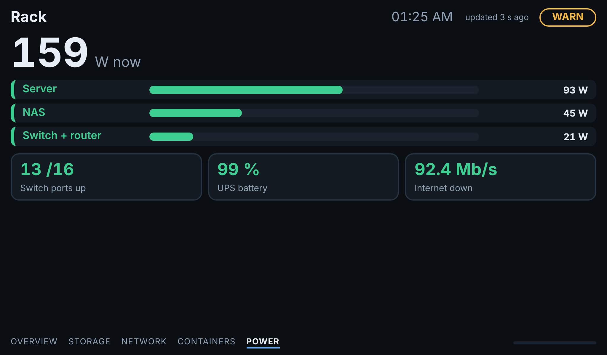
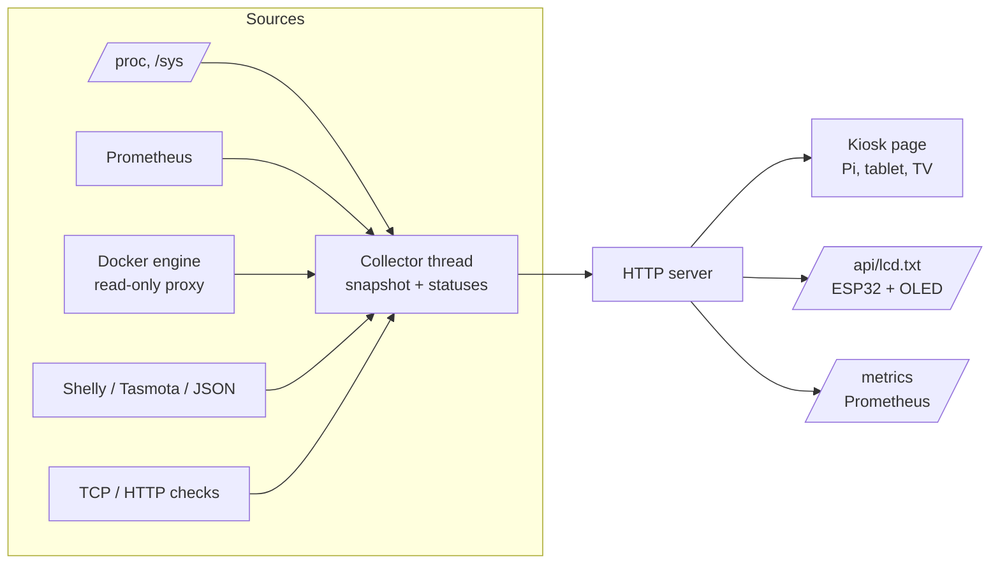

# rackdisplay - live rack statistics for a wall display

[](https://github.com/TexAlphaWolf/dc-rack-stats-display/actions/workflows/ci.yml)


A small server that shows what your rack is doing - CPU, RAM, disks, temperatures,
network, power draw, containers and services - on **any screen**: a 7-inch display on a
Raspberry Pi, an old tablet, a TV, or a tiny LCD/OLED driven by an ESP32.

It is hardware-independent on purpose: it serves a kiosk web page for anything with a
browser, and plain-text frames for anything with a few rows of characters.



| Containers | Power and extra numbers |
|---|---|
|  |  |

## Features
- **Five auto-rotating screens**: overview, storage, network, containers, power (empty ones are skipped).
- **Three data sources**: `local` (this Linux machine, from `/proc` and `/sys`), `prometheus`
  (any number of hosts, e.g. the [dc-monitoring-stack](https://github.com/TexAlphaWolf/dc-monitoring-stack)),
  `demo` (made-up data, to try it without anything installed).
- **Power**: Shelly (gen1/gen2), Tasmota or any HTTP endpoint returning JSON.
- **Containers** from the Docker engine, preferably through a read-only socket proxy.
- **Service checks** (TCP/HTTP) and **custom tiles** from any PromQL query, with warn/crit limits.
- **Small displays**: `/api/lcd.txt` returns pages of exactly `cols` x `rows` ASCII characters;
  an ESP32 + SSD1306 sketch is included.
- **Honest when things break**: if data stops arriving the page shows `NO DATA`, never stale numbers
  dressed up as fresh.
- `/metrics` in Prometheus format, `/healthz` for container health checks.
- **No runtime dependencies**: Python standard library only. Tested on 3.11 - 3.14.

## Quick start
```bash
pip install .                       # or: pip install git+https://github.com/TexAlphaWolf/dc-rack-stats-display
rackdisplay serve --demo            # open http://localhost:8080/
```
On Windows use `python -m rackdisplay serve --demo` if `rackdisplay` is not on the PATH.

Real data from the machine it runs on (Linux):
```bash
cp config.example.toml config.toml  # edit, then check it:
rackdisplay check-config -c config.toml
rackdisplay serve -c config.toml
```
Data from Prometheus (also works on Windows and macOS, as long as Prometheus can see the hosts):
```toml
# config.toml
[source]
type = "prometheus"
prometheus_url = "http://127.0.0.1:9090"   # on Windows 127.0.0.1 is much faster than localhost
```
```bash
rackdisplay serve -c config.toml
```

### Docker
```bash
cp config.example.toml config.toml
docker compose up -d                        # machine stats, checks, power
docker compose --profile containers up -d   # also list the containers
```
Open `http://<server>:8080/` on the display. To reach it from another device set
`RACKDISPLAY_BIND=0.0.0.0` **and** `RACKDISPLAY_TOKEN`. See [docs/security.md](docs/security.md).

## How it works

A background thread builds one snapshot every few seconds; every client only reads the latest
one, so ten displays cost the same as one. Statuses (ok / warn / crit / unknown) are computed
in one place from the thresholds, so the page, the LCD frames and `/metrics` always agree.

## Small displays
```
$ rackdisplay lcd --demo --cols 20 --rows 4
|RACK WARN           |
|rack C 10 M 35 49C  |
|nas  C 14 M 40 43C  |
|desk C 17 M 69      |
```
See [docs/hardware.md](docs/hardware.md) for the Raspberry Pi kiosk setup and the ESP32 sketch.

## Documentation
- [Configuration](docs/configuration.md)
- [Hardware: Raspberry Pi kiosk, ESP32](docs/hardware.md)
- [HTTP API and metrics](docs/api.md)
- [Security](docs/security.md)
- [Limitations](docs/limitations.md)

## Development
```bash
pip install -e ".[dev]"
ruff check . && ruff format --check . && mypy
pytest -m "not browser" --cov      # 85 tests, ~98% coverage
playwright install chromium && pytest -m browser   # the page in a real browser
```
The tests use fake HTTP servers, a fake Docker engine on a Unix socket and a fake `/proc` tree;
nothing needs real hardware. CI also builds the Docker image, starts it and queries it, and
compiles the ESP32 sketch.

## Limitations (short version)
The ESP32 sketch is compiled in CI but not tested on real hardware by the author. The `local`
source is Linux-only. Details in [docs/limitations.md](docs/limitations.md).

## License
MIT - see [LICENSE](LICENSE).
